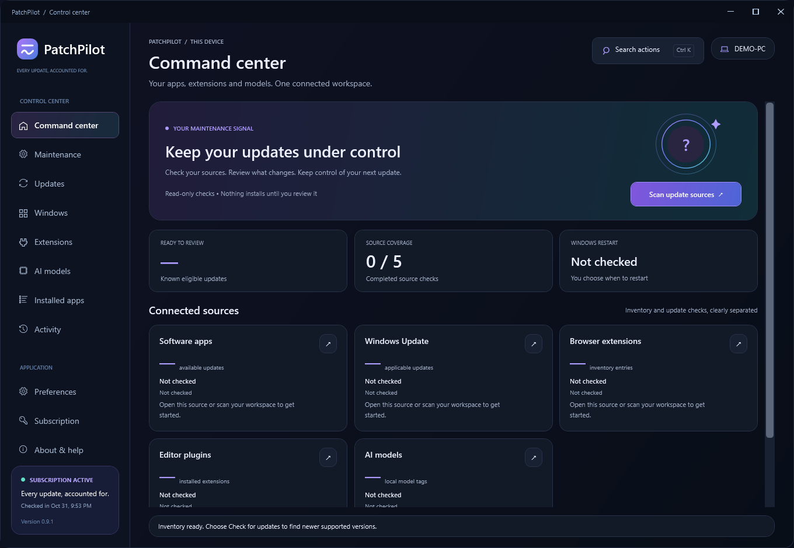

# PatchPilot

**Every update, accounted for.** Windows updates you review, approve and can trace. By **Prosper Technologies**.

[Website](https://prospertechnology.github.io/patchpilot/) · [Download v0.9.2](https://github.com/ProsperTechnology/patchpilot/releases/tag/v0.9.2) · [Full access — $1.99/month](https://prospertechnology.gumroad.com/l/patchpilot) · [Support](mailto:Keith.Hudson@gmx.com)

| Free plan — $0 | Full access — $1.99/month |
| --- | --- |
| Scan apps, Windows Update, browser/VS Code extensions and local Ollama models | Everything in Free |
| Available updates, installed-app inventory, history and CSV/HTML exports | Install reviewed app and Windows software updates |
| Recovery guidance, app repair and saved-version restore | Update VS Code extensions and refresh local Ollama model tags |
| No account needed to inspect your PC | Reviewed update retries and approved background maintenance |
| Free customer download | One PC; seven days offline after a successful check, capped by a known membership end |

Download the customer edition for the Free plan, then activate Full access using the key in your Gumroad receipt. Developer and LOOPBACK-TEST builds are not customer downloads.

## Requirements and limits

Windows 11 or Windows 10 22H2, x64. Desktop runtime included. WinGet (Microsoft App Installer) is required for app updates. Per-user installation; Windows updates require a separate administrator-approved review. Background maintenance is off until enabled and needs the installed copy and a signed-in Windows session.

**Early access, unsigned.** Windows may show SmartScreen or unknown-publisher warnings. Checksums confirm file integrity, not publisher identity or safety. Broad clean-machine and real vendor-update acceptance testing remains in progress. No Microsoft Store approval is claimed.

No driver updates, general rollback of arbitrary apps or Windows, antivirus or remote-PC management. Browser extensions stay browser-managed. VS Code supports its stable/Insiders default profile; Ollama is local only. Vendor installers may show their own terms and UAC prompts. PatchPilot never requests an automatic restart.

## Membership and privacy

$1.99 USD per month for one PC, plus applicable checkout taxes. Cancel in your Gumroad library; paid access continues until the effective membership end. Existing software and records stay in place, and an active update can finish. Transfers and revocations reach devices at their next check-in or cached entitlement expiry (up to seven days, capped by a known paid-through date).

Inventory, activity and reports stay local. Activation sends a license key, one-way device identifier, PC name and random request code to the Cloudflare-hosted license service. Gumroad verifies membership. [Privacy](https://prospertechnology.github.io/patchpilot/privacy.html) · [Terms](https://prospertechnology.github.io/patchpilot/terms.html).

Support: **Keith.Hudson@gmx.com**. Include the app/Windows versions and a short description. Never post license keys, personal paths or account details publicly.

Application source remains private. This repository contains public documentation, screenshots and customer release assets.

## New in v0.9.2

Setup offers optional desktop-shortcut and minimize-to-tray choices. Tray behavior can also be changed in Preferences. Double-click the tray icon to restore; closing the window still exits.
